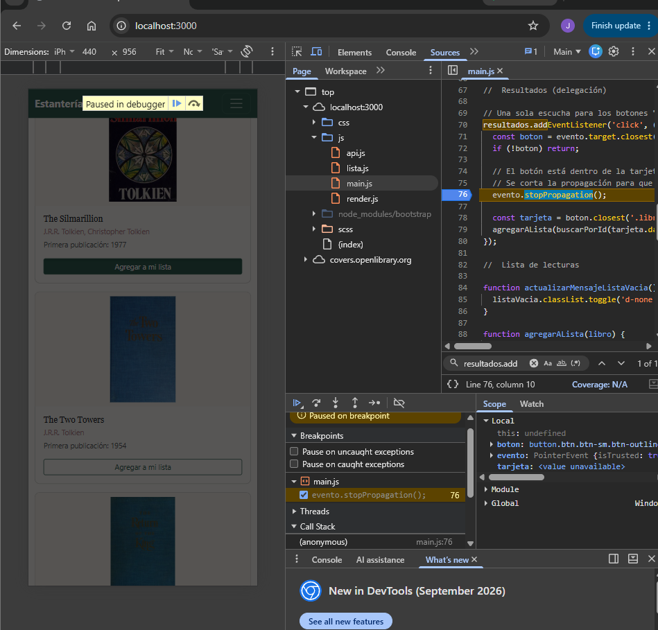
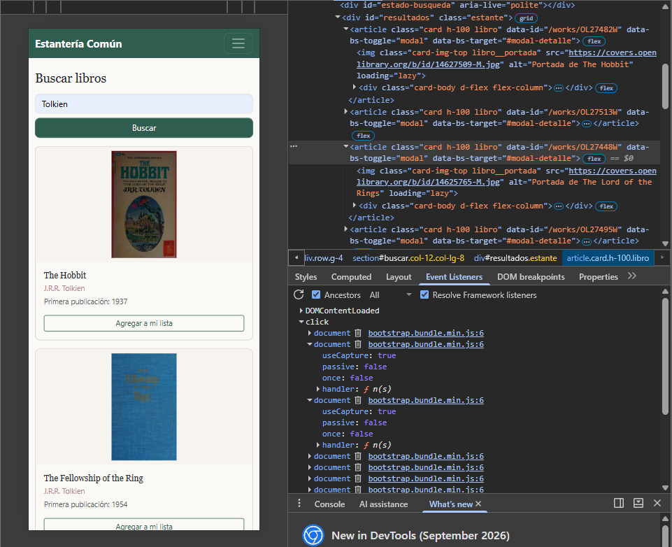
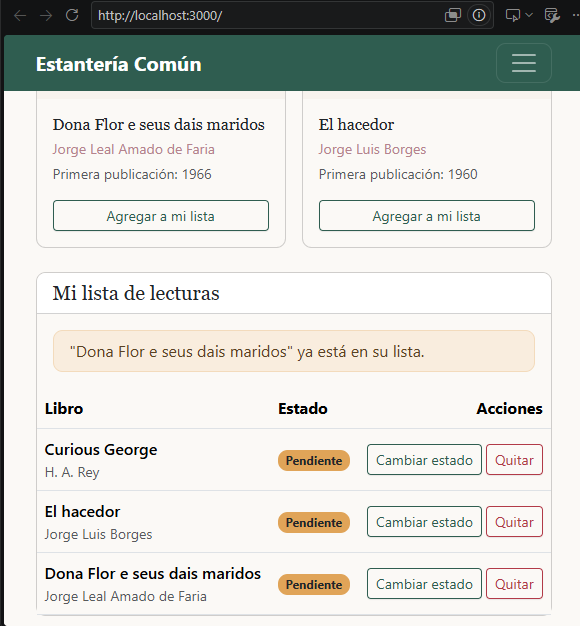
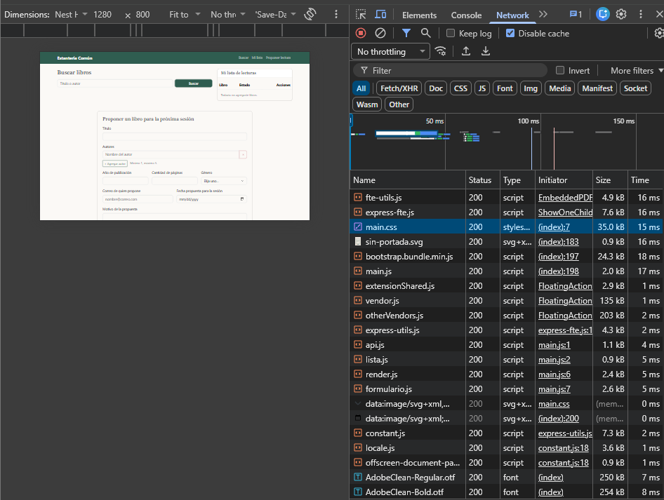
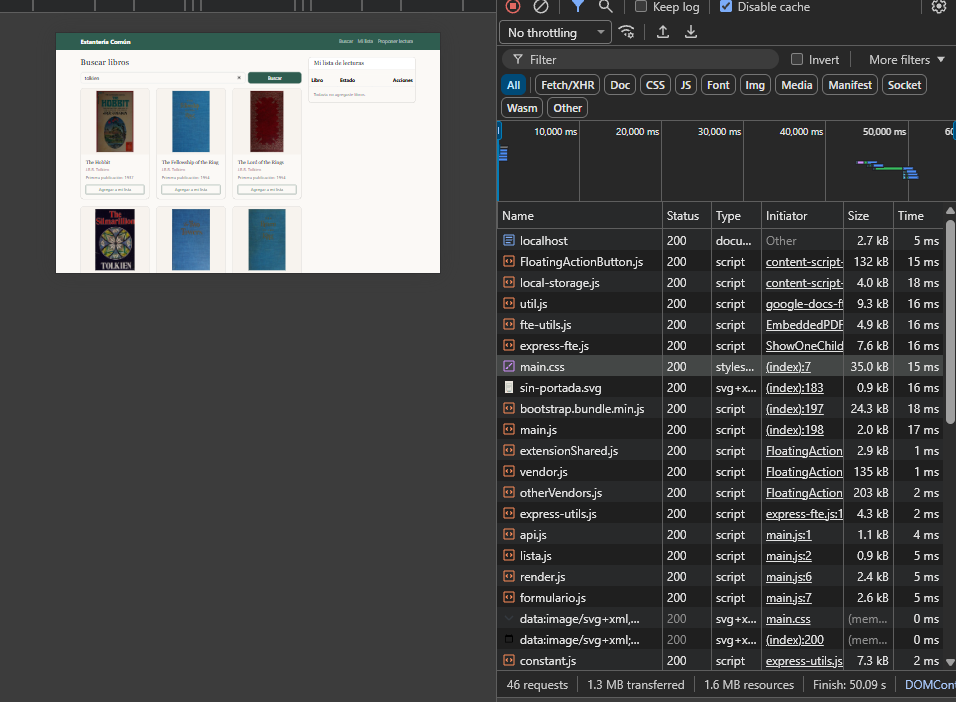
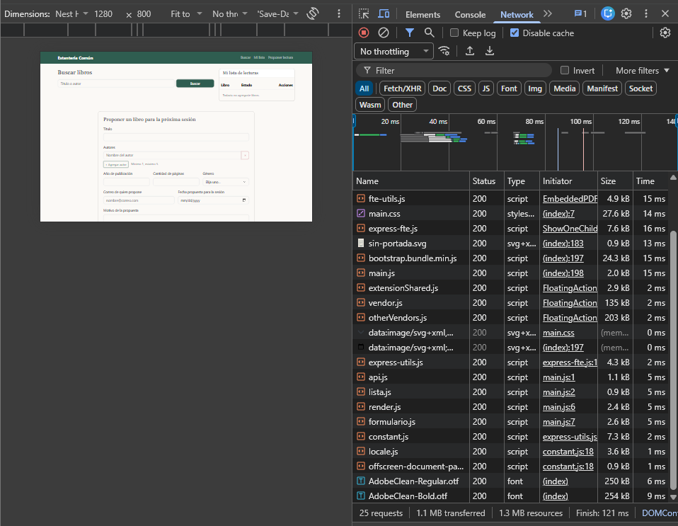

# Depuración y rendimiento (Parte A)

Todas las pruebas se hicieron en Google Chrome con las herramientas del desarrollador (F12), con la Parte A corriendo en http://localhost:3000.

## 1. Error encontrado: el botón "Agregar" también abría el modal

### Qué pasaba

En la primera versión las tarjetas de resultados abrían el modal de detalle con los atributos de Bootstrap `data-bs-toggle="modal"` y `data-bs-target="#modal-detalle"`. El botón "Agregar a mi lista" está dentro de la tarjeta, así que en la escucha delegada de `#resultados` le puse `event.stopPropagation()` para que el clic no llegara a la tarjeta.

Aun así, al tocar "Agregar" el libro se agregaba **y además** se abría el modal.

### Cómo lo localicé

1. En la pestaña **Sources** abrí `js/main.js` y puse un punto de interrupción en la línea de `evento.stopPropagation()` dentro de `resultados.addEventListener('click', ...)`.
2. Hice clic en "Agregar". La ejecución se detuvo en el breakpoint, antes de que corriera mi `stopPropagation()`.
3. Con la ejecución detenida, escribí en la consola `document.body.classList.contains('modal-open')` y dio `true`. Bootstrap pone esa clase cuando empieza a abrir un modal, así que el modal ya se estaba abriendo **antes** de que se ejecutara mi código. También revisé `evento.eventPhase`, que dio `3` (fase de burbuja).
4. Para entender por qué Bootstrap iba primero, en **Elements** seleccioné una tarjeta y abrí la pestaña **Event Listeners** con la casilla **Ancestors** marcada. Ahí se ve que Bootstrap registra su escucha de `click` en `document` con `useCapture: true`, o sea en la fase de captura.
5. Conclusión: el clic primero **baja** en fase de captura y pasa por `document`, donde Bootstrap abre el modal. Después **sube** en fase de burbuja hasta `#resultados`, donde estaba mi `stopPropagation()`. Para ese momento ya era tarde, porque `stopPropagation()` solo detiene lo que todavía no ha pasado.





### Cómo lo arreglé

Quité los atributos `data-bs-*` de las tarjetas y abrí el modal desde mi propio código. Ahora hay una escucha delegada en `<main>` que abre el detalle de cualquier elemento con `data-detalle` (tarjetas y filas de la lista), y llama a `bootstrap.Modal.getOrCreateInstance(...).show()` en `mostrarDetalle()` (`js/render.js`). Como esa escucha está en un ancestro y usa la fase de burbuja, el `stopPropagation()` de los botones "Agregar", "Cambiar estado" y "Quitar" sí la detiene.



### Un segundo aviso que salió en la consola

Al cerrar el modal, Chrome mostraba el aviso *"Blocked aria-hidden on an element because its descendant retained focus"*. Pasa porque Bootstrap pone `aria-hidden` en el modal mientras el botón de cerrar todavía tiene el foco. Lo resolví quitando el foco en el evento `hide.bs.modal` (`js/main.js`). Con eso la consola queda limpia durante el uso normal.

## 2. Análisis del panel de red

Pasos: pestaña **Network**, marcar **Disable cache**, recargar la página (Ctrl + Shift + R) y hacer una búsqueda de "tolkien".

Qué se carga al inicio: `index.html`, `css/main.css`, `bootstrap.bundle.min.js`, los cinco módulos de `js/` (cada `import` es una petición aparte) y `sin-portada.svg` solo si hace falta.

Al buscar se agrega una petición a `search.json` y hasta 12 a `covers.openlibrary.org`. Las portadas son lo que más pesa de la página. Por eso las imágenes llevan `loading="lazy"`: las tarjetas que no se ven en pantalla no descargan su portada hasta que el usuario baja.





## 3. Optimización: importar solo los parciales necesarios de Bootstrap

**Antes**, `scss/main.scss` importaba Bootstrap completo:

```scss
@import "variables";
@import "bootstrap/scss/bootstrap";
```

Eso incluye componentes que la página no usa (carrusel, acordeón, offcanvas, tooltips, popovers, toasts, paginación, breadcrumb, dropdowns, list group, progress, etc.).

**Después**, importé solo la configuración y los parciales que la página sí usa (grilla, tablas, formularios, botones, navbar, tarjetas, alertas, badges, modal, spinners, helpers y utilidades). Se puede ver la lista en `scss/main.scss`.

Medición de `css/main.css` (columna "Transferido" del panel de red, con caché desactivada):

| | Tamaño de `main.css` |
|---|---|
| Antes (Bootstrap completo) | 32 KB |
| Después (solo parciales usados) | 27 KB |


